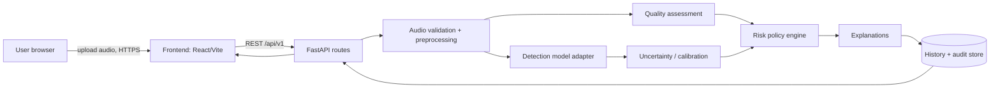
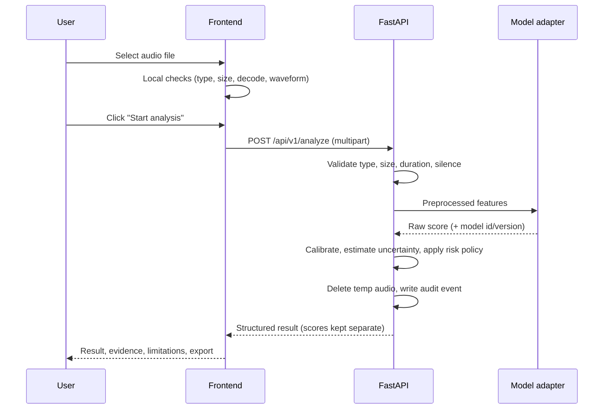

# VoxSentinel AI: Architecture

## 1. Why two separate applications?

| Concern | Choice | Reason |
|---|---|---|
| UI | React + Vite + TypeScript (`frontend/`) | Fast, typed, deployable to Base44, Vercel, Netlify, etc. |
| Detection | Python + FastAPI (`backend/`) | Audio ML libraries (librosa, scikit-learn, PyTorch) are Python-only. Base44 hosts JavaScript only. |

The frontend never contains model logic. It talks to the backend only through the
versioned REST API in `API_CONTRACT.md`. The backend URL is configured with
`VITE_API_BASE_URL`.

## 2. System diagram



## 3. Data flow for one analysis



## 4. Score vocabulary (never mixed silently)

| Term | Meaning |
|---|---|
| Raw model score | Unscaled model output. Not a probability. |
| Calibrated probability | Raw score mapped on validation data. Only exists if calibration was run. |
| Uncertainty estimate | Explicit method (documented per model). Absent if unsupported. |
| Risk category | Application-level policy decision from thresholds in config. |

Risk categories: `low_observed_risk`, `elevated_risk`, `high_risk`, `inconclusive`,
plus the status `unable_to_analyze`.

## 5. Honest-state principle

Every UI region that depends on the backend has four states: loading, empty,
error, populated. If the backend or model is unavailable the UI says so. It does
not display placeholder statistics or fabricated predictions.

## 6. Planned backend modules (Phase 4+)

```
backend/app/
  main.py                      FastAPI app factory, CORS, middleware
  api/routes.py                Endpoints
  core/config.py               Settings and risk thresholds
  services/audio_preprocessing.py
  services/detection_service.py   Model adapter interface
  services/speaker_verification.py
  services/uncertainty.py
  services/risk_engine.py
  services/explanations.py
  schemas/analysis.py          Pydantic models
  storage/history.py
backend/tests/
```


## ML pipeline (Phase 5)

```
audio (mono float32)
  -> resample to 16 kHz, take/pad first 4 s        (app/services/features.py)
  -> librosa MFCC (20 coeffs) -> mean+std          (shared by training AND inference)
  -> StandardScaler (fit on train only, in artifact)
  -> LogisticRegression -> P(synthetic) = raw_score (uncalibrated)
  -> risk engine (provisional thresholds)          (app/services/risk_engine.py)
  -> decision + recommendations + explanation
```

- Training: `scripts/train_detector.py` (manifest partitions, leakage checks,
  recorded seed and versions, artifact + JSON training report).
- Serving: `app/services/model_loader.py` validates the artifact (format,
  version, classes, fitted estimators, feature config) before the API reports
  `model_ready: true`. Any failure = `NullVoiceDetector` = honest 503.
- Final metrics: `scripts/evaluate_detector.py` on the untouched `eval`
  partition (precision/recall/F1, confusion matrix, FPR/FNR, ROC-AUC, EER).
- The smoke fixture (tones vs noise) validates mechanics only. No real-data
  results exist yet; see docs/MODEL_CARD.md.
